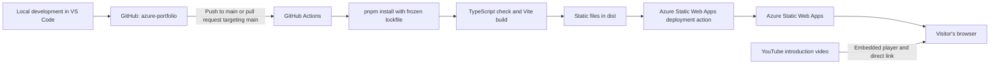

# Azure Portfolio · Introduction

The website is the introduction to my Azure project journey: a place to showcase my skills, experience, project repositories, written notes, and recorded walkthroughs.

[Watch the introduction](https://youtu.be/pgwBtNrTJS4).

## 1. The business problem it solves

A list of technologies does not show how I approach a problem. I need a place where someone reviewing my work can follow what I built, why I made each decision, where I struggled, and what I would change for a production environment.

This portfolio brings that evidence together. The connected project path shows how each build leads into the next, while the video library gives me a place to share walkthroughs after I finish and document each project.

### What I completed for the introduction

- Activated an Azure for Students subscription and created the `azure-portfolio` resource group.
- Set up a monthly budget and spending alerts.
- Created this GitHub repository and configured my local Git setup.
- Built the portfolio using React, TypeScript, Vite, Tailwind CSS, and GSAP.
- Set up Azure Static Web Apps and configured its GitHub Actions build and deployment workflow.
- Added the supplied introduction video to the first project and the shared video library.

The infrastructure, monitoring, and Terraform CI/CD projects below are planned work. The website's existing deployment workflow is part of this introduction; it is separate from the future Terraform pipeline.

## 2. The architecture diagram



The workflow in `.github/workflows/azure-static-web-apps-icy-stone-01026931e.yml` builds the site before handing the `dist/` output to the Azure deployment action. The action uses a deployment token stored in GitHub Actions secrets. A separate job closes the pull-request environment when the pull request closes.

`public/staticwebapp.config.json` sends application routes such as `/videos` to `index.html`, with static assets excluded from that fallback. The current application has no custom backend or database: profile details, project content, and video references live in the source repository.

## 3. The key decisions and why I made them

| Decision | Why it fits this project | Tradeoff |
| --- | --- | --- |
| Use Azure Static Web Apps for a static portfolio | It gives this introduction a focused Azure hosting setup without needing an application server. | Backend features would need a separate design if the site's requirements grow. |
| Build with React, TypeScript, and Vite | Reusable components support the project path and video library; TypeScript catches type errors before deployment. | A client-rendered application adds JavaScript and needs route fallback configuration. |
| Build in GitHub Actions, then deploy `dist/` | The repository records the build process, and the Azure action receives the output of that build. | Changes to the workflow and its deployment access need careful review. |
| Keep content in `src/data/portfolio.ts` | One collection supplies project information and videos to the site, making updates straightforward while the portfolio is small. | Content changes require a code change and deployment. |
| Embed the introduction from YouTube and provide a direct link | The site can showcase the recording without storing and serving the video file itself. | Playback depends on a third-party service and the video's availability. |
| Keep the purple-and-yellow arcade theme | The player profile, connected path, and vault introduction reflect my gamer and tech interests. | Animation and media need accessibility and performance checks as the site evolves. |

### Document the work as it happens

Each project will have its own GitHub repository with these same four README sections: the business problem, the architecture diagram, key decisions and their rationale, and changes for production scale.

Start each repository with the [project README template](docs/project-readme-template.md), which includes a build-note entry for struggles, alternatives, decisions, verification, and open questions.

During each build, I will keep notes on the problem I encountered, what I tried, the result, the decision I made, and the evidence behind it. Those notes should include unsuccessful attempts and alternatives considered. I will record actual struggles as they happen, rather than present a polished result without the reasoning behind it.

After completing the build and written documentation, I will record a walkthrough and add its video and repository link to this portfolio. The introduction video is already available; videos and repositories for the planned projects will be linked when they exist.

### The project sequence

1. **Infrastructure and automation.** Build an Azure environment with Terraform: a hub-and-spoke virtual network, network security groups with least-privilege rules, a virtual machine in a private subnet, a storage account with a private endpoint, and remote Terraform state in Azure Blob Storage.
2. **Monitoring and Alerting.** Connect Azure Monitor to a Log Analytics workspace. Write KQL detection rules for failed login attempts, suspicious access patterns, and configuration changes to privileged resources. Use a Logic App to send formatted alerts when rules fire.
3. **CI/CD Pipeline.** Connect the Terraform repository to GitHub Actions, run Terraform validate and plan on every commit, require manual approval before apply, and protect `main` from direct commits. Explain the business value of reviewed, repeatable infrastructure changes.

Each stage builds on the previous one: provision the environment, observe its behavior, then control how infrastructure changes reach it.

### Certification goals after the projects

CompTIA Security+ is earned. AZ-104 and AZ-900 are planned goals after these builds; AZ-900 replaces the earlier AZ-500 target.

### Run locally

Use Node.js 22.12 or newer and pnpm 11.25.0. From the project folder:

```sh
pnpm install
pnpm dev
```

Open the local address printed in the terminal. To run the TypeScript check and production build:

```sh
pnpm typecheck
pnpm build
```

Production files are created in `dist/`. Preview that build with:

```sh
pnpm preview
```

### Update the portfolio

- `src/data/portfolio.ts` holds profile details, credentials, certification goals, project content, the four README sections, and the shared video collection.
- `src/components/ProjectJourney.tsx` and `project-journey.css` render the connected project path.
- `src/components/LearningApproach.tsx` and `learning-approach.css` render the documentation approach and certification goals.
- `public/assets/portrait.jpg` is the homepage portrait.
- `src/components/VaultIntro.tsx` and `vault-intro.css` control the vault artwork, timing, and intro controls.
- `public/assets/vault-intro-audio.mp3` contains the selected intro music excerpt.

The homepage and Videos page use the same video collection, which supports YouTube videos, uploaded video files, and links to recordings. The vault intro has skip, sound, and replay controls so visitors can choose how to enter the portfolio.

## 4. What I would do differently at production scale

These are proposed changes, not claims about the current setup. I would size the work to the service's users, availability needs, and budget.

- **Protect releases.** Require pull-request review and passing checks, separate preview and production configuration, and document a tested rollback process. Add approval requirements where the impact of a change warrants them.
- **Review deployment access.** Limit workflow and Azure permissions, review how deployment credentials are stored and rotated, and use short-lived identity where the chosen deployment tooling supports it.
- **Make operations measurable.** Define availability targets, configure monitoring and actionable alerts, and document who responds and how to investigate an incident. Review costs and alert thresholds as usage grows.
- **Verify security and routing.** Review security headers, HTTPS and custom-domain configuration, dependency updates, route fallbacks, and third-party embeds. Validate changes against the actual application rather than assume a successful build proves they work.
- **Measure accessibility and performance.** Check keyboard navigation, reduced-motion behavior, contrast, mobile layouts, and page performance. Optimize assets and the intro based on measurements while preserving access to the core project content.
- **Evolve content management only when needed.** Keep content in version control while it remains manageable. If multiple contributors or frequent updates make that process difficult, consider a publishing workflow with previews and review before adding a CMS or backend.

The next projects will apply this same distinction between a learning environment and a production service: explain the choices made for the lab, then identify what would need to change as requirements and risk increase.
