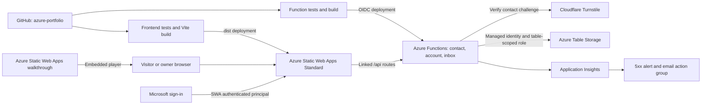
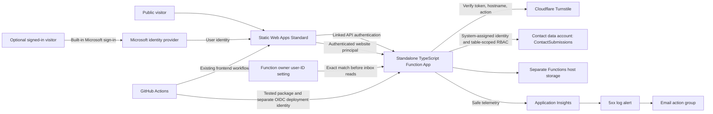

# Azure Portfolio & Contact System

My completed first cloud project: a React portfolio on Azure Static Web Apps, a validated contact API, Microsoft sign-in, and a private owner inbox backed by Azure Table Storage. The site also documents my experience, certifications, project decisions, and next steps in cloud engineering.

**Portfolio content updated November 22, 2026:** IT Analyst at Iron Bow Technologies; Digital Forensics Intern at Virginia State Police; CompTIA Security+ and Microsoft Azure Fundamentals (AZ-900) earned. AZ-104 remains planned. The Enterprise Service Desk API is the next project.

[Watch the Azure Static Web Apps walkthrough](https://youtu.be/pgwBtNrTJS4).

## 1. The business problem it solves

A list of technologies does not show how I approach a problem. I need a place where someone reviewing my work can follow what I built, why I made each decision, where I struggled, and what I would change for a production environment.

This portfolio brings that evidence together. The connected project path shows how each build leads into the next, while the video library gives me a place to share walkthroughs after I finish and document each project.

### What I completed for Project 01

- Activated an Azure for Students subscription and created the `azure-portfolio` resource group.
- Set up a monthly budget and spending alerts.
- Created this GitHub repository and configured my local Git setup.
- Built the portfolio using React, TypeScript, Vite, Tailwind CSS, and GSAP.
- Set up Azure Static Web Apps and configured its GitHub Actions build and deployment workflow.
- Added the supplied Azure Static Web Apps video to the first project and the shared video library.
- Built a validated contact form with server-verified Cloudflare Turnstile.
- Stored submissions in Azure Table Storage through the Function's managed identity.
- Added personal Microsoft sign-in and explicit server-side owner authorization for the private inbox.
- Verified Application Insights telemetry, configured a 5xx alert, and verified notification email delivery with a temporary test rule.
- Automated standalone Function deployments with GitHub Actions and OIDC, alongside the frontend deployment workflow.

The roadmap has four projects total. The Azure Portfolio & Contact System is completed. The Enterprise Service Desk API comes next, followed by a secure network and governance lab, then a reliability and recovery lab. CI/CD and basic monitoring are integrated capabilities, rather than separate portfolio projects.

## 2. The architecture diagram



The workflow in `.github/workflows/azure-static-web-apps-icy-stone-01026931e.yml` tests and builds the site before handing the `dist/` output to the Azure deployment action. The action uses a deployment token stored in GitHub Actions secrets. A separate job closes the pull-request environment when the pull request closes. `.github/workflows/deploy-function-app.yml` tests, packages, and deploys the standalone Function App using OIDC; see the [Function delivery notes](docs/contact-phase-5.md).

`public/staticwebapp.config.json` sends application routes such as `/videos` to `index.html`, with static assets, `/api/*`, and `/.auth/*` excluded from that fallback. Profile details, project content, and video references live in the source repository. The contact API in `functions/` is deployed separately. The public form, personal sign-in, and private inbox are deployed. A [server-side owner authorization repair](docs/inbox-owner-repair.md) now checks one explicitly configured website identity after reproducing inconsistent Azure custom roles. Repeated owner reads and anonymous/forged-header denial checks passed in production.

## 3. The key decisions and why I made them

| Decision | Why it fits this project | Tradeoff |
| --- | --- | --- |
| Use Azure Static Web Apps with a linked standalone Function App | SWA hosts the frontend and Microsoft sign-in while the Function handles validation, storage, and owner authorization. | Standard hosting and the separate backend have their own costs, configuration, and release paths. |
| Build with React, TypeScript, and Vite | Reusable components support the project path and video library; TypeScript catches type errors before deployment. | A client-rendered application adds JavaScript and needs route fallback configuration. |
| Build in GitHub Actions, then deploy `dist/` | The repository records the build process, and the Azure action receives the output of that build. | Changes to the workflow and its deployment access need careful review. |
| Keep content in `src/data/portfolio.ts` | One collection supplies project information and videos to the site, making updates straightforward while the portfolio is small. | Content changes require a code change and deployment. |
| Embed the walkthrough from YouTube and provide a direct link | The site can showcase the recording without storing and serving the video file itself. | Playback depends on a third-party service and the video's availability. |
| Keep the purple-and-yellow arcade theme | The player profile and connected project path reflect my gamer and tech interests. | Animation and media need accessibility and performance checks as the site evolves. |

### Why I chose Table Storage for the contact form

I store each contact submission as one record with a name, email, message, and date. Table Storage lets the inbox query complete records in pages. With JSON blobs, I would usually need to list objects and then download their contents to assemble the same page.

The keys support the inbox's newest-first access pattern, and the Function uses managed identity instead of a storage key. General fields are not secondary indexes, so I would revisit this design if I needed full-text search or complex reporting.

### Contact form and admin inbox — completed build

I want visitors to be able to reach out without creating an account, while keeping their messages out of the public portfolio. I also want a private inbox that demonstrates the difference between signing in, getting permission to view messages, and giving an application permission to store them.

I completed the Azure setup one phase at a time. [Phase 1: public form and linked Function App](docs/contact-phase-1.md) records the original setup. [Phase 3: sign-in and private inbox](docs/contact-phase-3.md) covers personal Microsoft sign-in and access tests. The form keeps the existing purple-and-yellow design. It includes server validation, a honeypot, server-verified Turnstile, and sending, validation, success, and retry states. Failed requests keep the draft on the current page. The API reports success only after storage confirms a write.

This is the current application architecture. Both website and Function deployments run through GitHub Actions; the Function workflow uses a dedicated federated identity and a tested release package. Its [first automated production deployment](docs/contact-phase-5.md) succeeded on November 20, 2026. Front Door/WAF was attempted but blocked by the student subscription and is deferred; see the [monitoring and deployment evidence](docs/monitoring-and-front-door.md).



The storage writer uses partition key `inbox` and a fixed-width reverse timestamp plus a random ID as the row key. Table Storage sorts by partition and row key, giving newest submissions first within this partition. The inbox requests up to 20 records and passes the SDK continuation token for the next page. It always uses the same partition filter; the cursor cannot select another table or change permissions. Paging is not a snapshot: refreshing starts again with the newest messages. A single partition suits this portfolio but would become a throughput bottleneck at larger scale.

**Current evidence — November 19, 2026:** Azure reported a successful Function deployment. An invalid request through SWA returned the API's `400 validation_failed`, while a direct call to the Function hostname returned `401`. The public form displayed a successful receipt in an InPrivate browser after Turnstile verification. The storage account setting showed Shared Key disabled, and role listings showed the Function's table-scoped contributor role and my separate reader role. These observations support the public submission path; they do not prove every access boundary. Independent entity inspection, broader RBAC audit, forged-header tests, and negative storage authorization tests still need recorded evidence.

The initial phase 3 release passed 25 backend tests, 18 frontend tests, and the production frontend build locally. A session-recovery experiment was rolled back after worse production access was reported. The deployed owner authorization repair passes 27 backend tests, 18 frontend tests, and the build. Six production inbox loads/refreshes succeeded without another sign-in. The separate-account test was user-reported rather than independently verified; live owner-setting revocation remains untested. [Production evidence](docs/evidence/inbox-owner-release-2026-11-20.json) records the scope. [Desktop](docs/evidence/phase-3-inbox-desktop.jpg) and [mobile](docs/evidence/phase-3-inbox-mobile.jpg) previews use synthetic messages. Monitoring and email delivery are now verified as described below. Front Door/WAF is deferred after a subscription rejection. The [separate Function workflow](docs/contact-phase-5.md) has completed its first production deployment. Six post-deployment endpoint checks passed, and the user confirmed that the signed-in inbox still loads; [release evidence](docs/evidence/function-cicd-release-2026-11-20.json) records the exact scope.

**Decisions and tradeoffs:** Windows Consumption was blocked by Y1 quota restrictions on my student subscription. I created `func-portfolio-contact` on Linux Flex Consumption in West US 2. The runtime account `stpfhost` is separate from `stpfcontact`, where Shared Key is disabled. The storage client defaults to managed identity. Local development explicitly selects my Azure CLI identity through `CONTACT_STORAGE_USE_AZURE_CLI=true` in the ignored local settings. Separate frontend and Function workflows deploy each component. The Function deployment identity is scoped to its app and uses OIDC instead of a stored client secret. Browser drafts stay in memory instead of persisting contact details on a shared device. A network timeout can leave delivery uncertain, so retrying may create a duplicate. Durable idempotency is a production improvement.

**Costs:** SWA is now on Standard. I track its recurring charge along with Functions execution, both storage accounts, monitoring ingestion/retention, and bandwidth. Front Door creation was rejected despite available student credit; the unused WAF policy was removed according to the user's cleanup report. Revisit subscription eligibility and the full quote before attempting that lab again. Budget alerts are notifications, not a hard spending cap. Current [SWA pricing](https://azure.microsoft.com/en-us/pricing/details/app-service/static/) and [Front Door pricing](https://azure.microsoft.com/en-us/pricing/details/frontdoor/) are the references; my actual subscription quote takes precedence.

**Build note — November 8, 2026:** The first backend compile found a mismatch between Node and browser stream types. I narrowed the request interface to the reader methods the handler actually needs, then verified chunked and oversized bodies. Another decision was to make missing storage fail clearly instead of returning a success message for a discarded submission. The automated failure-path tests prove those local behaviors; Azure permissions still need live evidence.

**Build note — sign-in and inbox:** I kept the account page public so a visitor can choose to sign in. SWA authenticates private API requests; the repaired Function authorizes the exact configured owner before reading data. Hiding a navigation link is only presentation. Messages render as text and stay in memory, with `no-store` responses. The website uses SWA's built-in Microsoft provider, while the Function uses its own managed identity for storage. The [identity map](docs/contact-phase-3.md) and [repair runbook](docs/inbox-owner-repair.md) explain those separate boundaries.

**Build note — November 20, 2026:** My original single-tenant registration reached the university's administrator-consent screen after I enabled ID-token issuance. I chose built-in Microsoft sign-in for my personal account, which can use Gmail as its username. This intentionally replaced the tenant-restricted requirement: other Microsoft accounts could sign in, while the initial inbox release required `site_admin`. GitHub sign-in is explicitly blocked. This choice does not change university policies or transfer my Azure subscription. The previous custom registration and sign-in identity are no longer referenced by the website configuration; I will review and remove the dedicated unused Azure resources after verification. User-provided screenshots subsequently confirmed personal sign-in, `isAdmin: true`, and a stored test message in the inbox.

The [November 20 live probes](docs/evidence/phase-3-personal-signin-release.json) verified public page access, contact validation, denied anonymous and forged-principal requests, blocked GitHub login, and the new shared Microsoft login redirect. All 43 tests at that release and the production build passed. Later screenshots provided the separate evidence of completed login and an admin read.

**Build note — authorization reliability:** The inbox sometimes denied access within seconds despite a successful account check. A frontend retry experiment was rolled back after worse production access was reported. Direct inspection then showed Azure's `/.auth/me` alternating `site_admin` for the same authenticated identity; the inbox API returned a platform `403`. Reapplying the role and signing in again did not restore consistent roles. I deployed an explicit Function owner-ID policy so authentication remains with Azure and the application makes its own authorization decision. Other users are denied even if they carry `site_admin`; missing configuration denies all reads. Repeated production owner reads now pass, as do anonymous and fabricated-owner-header denial checks. Revocation means changing or clearing the Function's owner setting, rather than changing a SWA custom role; its live propagation timing remains untested. The underlying Azure role inconsistency remains unconfirmed internally.

**Build note — HTTP routing:** The three-function listing initially hid a route problem: `/api/account` returned the expected `401`, but `/api/admin/submissions` returned `404`. The local Azure Functions runtime reproduced a reserved-route conflict. I corrected the trigger templates to contain their full `api/` path and cleared the global prefix. All public URLs remain the same. A new regression test and five [local runtime probes](docs/evidence/phase-3-runtime-routing.json) verify the correction. After redeployment, the live inbox endpoint returned `401 unauthorized` with `no-store`, confirming that unsigned requests reach the corrected handler and are denied. A later production screenshot showed a successful signed-in read.

**Build note — monitoring and subscription limits:** fresh Application Insights requests and the permanent `alert-portfolio-api-5xx` configuration were verified. A temporary rule on successful account requests generated a real email, verifying notification delivery without deliberately breaking the API. The built-in action-group test was rejected for the free subscription. Front Door then passed wizard validation but failed deployment with `Free Trial and Student account is forbidden for Azure Frontdoor resources`. The [evidence and closeout notes](docs/monitoring-and-front-door.md) distinguish verified behavior, reported cleanup, and remaining checks. The 5xx rule itself has not been exercised with a real 5xx incident.

**Production improvements:** add durable idempotency, a documented retention/deletion policy, measured monitoring costs, a delivery/support process, and a tested restore strategy. Revisit separate writer/reader service identities if the backend grows. Complete the remaining live owner-setting revocation and negative storage-permission checks. Record only test messages in walkthroughs; previously viewed data cannot be recalled from a recipient's device.

### Document the work as it happens

Each project will have its own GitHub repository with these same four README sections: the business problem, the architecture diagram, key decisions and their rationale, and changes for production scale.

Start each repository with the [project README template](docs/project-readme-template.md), which includes a build-note entry for struggles, alternatives, decisions, verification, and open questions.

During each build, I will keep notes on the problem I encountered, what I tried, the result, the decision I made, and the evidence behind it. Those notes should include unsuccessful attempts and alternatives considered. I will record actual struggles as they happen, rather than present a polished result without the reasoning behind it.

After completing each build and its written documentation, I will record a walkthrough and add its video and repository link to this portfolio. The Azure Static Web Apps walkthrough is already available; videos and repositories for planned projects will be linked when they exist.

### The four-project roadmap

| Project | Distinct capability | Evidence to show |
| --- | --- | --- |
| **1. Azure Portfolio & Contact System — completed** | Ship a working serverless service: frontend, API validation, identity, storage, basic monitoring, and automated releases. | Live portfolio, contact/inbox access checks, architecture, deployment history, and the recorded walkthrough. |
| **2. Enterprise Service Desk API — up next** | Build and deliver a containerized application: ASP.NET Core, PostgreSQL, ticket workflows, application roles, audit logs, tests, and vulnerability scans. | Synthetic ticket scenarios, permission tests, API documentation, a reviewed pull request, and an automated Azure Container Apps release using Terraform and OIDC. Include remote state, reviewed plans, a deployment approval gate, and rollback instructions. |
| **3. Secure Azure Network & Governance Lab — planned** | Operate the platform: hub-and-spoke networking, private endpoints and DNS, Linux administration, Azure RBAC, Azure Policy, and network troubleshooting. | A small single-subscription lab, Terraform, a network diagram, an allowed/denied access matrix, a blocked public-storage request, a policy-rejected deployment, and a diagnosed DNS or NSG fault. |
| **4. Cloud Reliability & Recovery Lab — planned** | Diagnose and recover a service: KQL investigation, service-health targets, bounded load tests, incident response, database restore, and measured recovery. | A test copy of the Service Desk API, two incident rehearsals, one load-test report, a verified PostgreSQL restore, measured recovery time/data loss, runbooks, and a postmortem. |

The sequence is **publish → develop → secure → recover**. Projects 2–4 are plans, not completed experience. Each gets a focused repository and README with the architecture, decisions, commands, test results, costs, and cleanup steps.

**Overlap removed:** the standalone CI/CD project is folded into the Service Desk API, building on the pipelines already running this portfolio. The basic monitoring project is replaced by measurable troubleshooting and recovery work; setting up another dashboard or email alert alone is not the fourth project's outcome. Terraform and monitoring remain tools used across the builds, while each project has a different problem and proof of success.

**Keep the labs achievable:** project 3 is a small network/governance exercise, not a claim to have implemented a complete enterprise landing zone. Project 4 uses synthetic data and a separate test deployment. Define recovery-time (RTO) and acceptable-data-loss (RPO) targets before rehearsing recovery, then report actual results. Select the PostgreSQL backup/restore method for the chosen hosting option and verify restored data and application behavior. Document regional failover as a future improvement unless it is actually tested. Check student-subscription eligibility, resource quotas, and costs before provisioning; include teardown and keep always-on resources limited.

The capability choices are informed by Microsoft's [Azure administrator skills](https://learn.microsoft.com/en-us/credentials/certifications/resources/study-guides/az-104), [landing zone design areas](https://learn.microsoft.com/en-us/azure/cloud-adoption-framework/ready/landing-zone/design-areas), and [reliability testing guidance](https://learn.microsoft.com/en-us/azure/well-architected/reliability/reliability-test). This portfolio is selected practical evidence, not a complete exam syllabus or a claim of production-scale experience.

### Certification roadmap

CompTIA Security+ and AZ-900 are earned. AZ-104 is the next certification goal.

### Run locally

Use Node.js 22.12 or newer and pnpm 11.25.0. From the project folder:

```sh
pnpm install
pnpm dev
```

Open the local address printed in the terminal. To run the TypeScript check and production build:

```sh
pnpm typecheck
pnpm test
pnpm build
```

Production files are created in `dist/`. Preview that build with:

```sh
pnpm preview
```

The Vite preview serves the frontend. Azure sign-in and `/api/*` require the deployed SWA/Function integration; a local Vite server alone does not emulate them. Configure the public `VITE_TURNSTILE_SITE_KEY` in an ignored `.env.local` for a permitted test hostname when testing the form. Keep the Turnstile secret in backend settings. A preview without that configuration shows the setup/unavailable state.

The backend is a separate package. Run its automated checks with:

```sh
pnpm --dir functions install --frozen-lockfile
pnpm --dir functions test
```

For a local Function runtime, use Azure Functions Core Tools and the settings described in [phase 1](docs/contact-phase-1.md), starting from `functions/local.settings.example.json`. Production owner access and storage permissions need separate live verification.

### Update the portfolio

- `src/data/portfolio.ts` holds profile details, credentials, certification goals, project content, the four README sections, and the shared video collection.
- `src/components/ProjectJourney.tsx` and `project-journey.css` render the connected project path.
- `src/components/LearningApproach.tsx` and `learning-approach.css` render the documentation approach and certification goals.
- `public/assets/portrait.jpg` is the homepage portrait.
- `src/components/VaultIntro.tsx` and `vault-intro.css` retain the vault artwork, timing, and intro controls for possible reuse; the intro is currently disabled.
- `public/assets/vault-intro-audio.mp3` contains the selected intro music excerpt.

The homepage and Videos page use the same video collection, which supports YouTube videos, uploaded video files, and links to recordings. The supplied recording is labeled to match its current YouTube title: Azure Static Web Apps, security, deployment, and monitoring. The site opens directly to the requested page, with no vault intro or replay button. The November 22 roadmap revision preserves the existing design with four project stages. Existing links to projects 3 and 4 still work; the retired CI/CD link redirects to the Service Desk API, where that work now belongs.

The project icons gently float along a flowing dashed route, the portrait's yellow sparkle twinkles, and certification markers pulse. These decorative CSS loops leave text and click targets stationary. They follow the device's reduced-motion setting by default. The **Play animations / Pause animations** button above the homepage heading lets visitors override that default and remembers their choice locally. The override applies only to these decorative loops; reduced-motion behavior for scrolling and page transitions stays unchanged. `src/hooks/useIdleMotion.ts` manages the preference; the styles live in `project-journey.css`, `homepage.css`, and `learning-approach.css`.

## 4. What I would do differently at production scale

These are proposed changes, not claims about the current setup. I would size the work to the service's users, availability needs, and budget.

- **Protect releases.** Require pull-request review and passing checks, separate preview and production configuration, and document a tested rollback process. Add approval requirements where the impact of a change warrants them.
- **Review deployment access.** Limit workflow and Azure permissions, review how deployment credentials are stored and rotated, and use short-lived identity where the chosen deployment tooling supports it.
- **Make operations measurable.** Define availability targets, configure monitoring and actionable alerts, and document who responds and how to investigate an incident. Review costs and alert thresholds as usage grows.
- **Verify security and routing.** Review security headers, HTTPS and custom-domain configuration, dependency updates, route fallbacks, and third-party embeds. Validate changes against the actual application rather than assume a successful build proves they work.
- **Measure accessibility and performance.** Check keyboard navigation, reduced-motion behavior, contrast, mobile layouts, and page performance. Optimize assets and the intro based on measurements while preserving access to the core project content.
- **Evolve content management only when needed.** Keep content in version control while it remains manageable. If multiple contributors or frequent updates make that process difficult, consider a publishing workflow with previews and review before adding a CMS or backend.

The next projects will apply this same distinction between a learning environment and a production service: explain the choices made for the lab, then identify what would need to change as requirements and risk increase.
